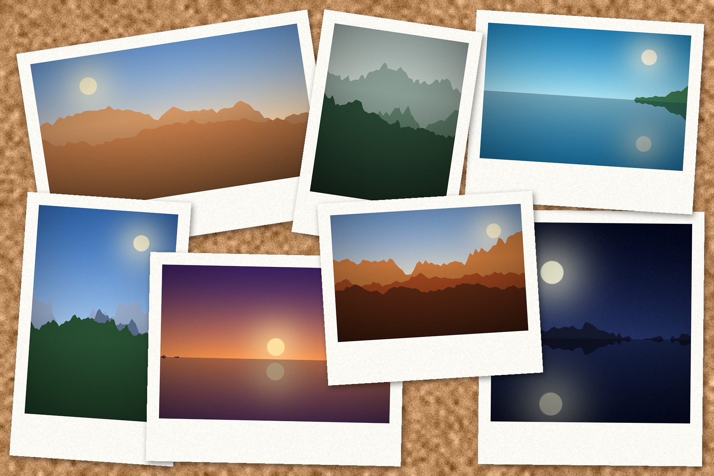
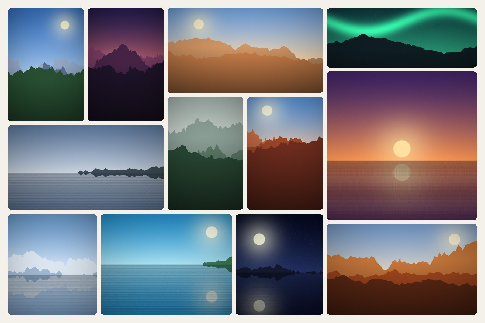
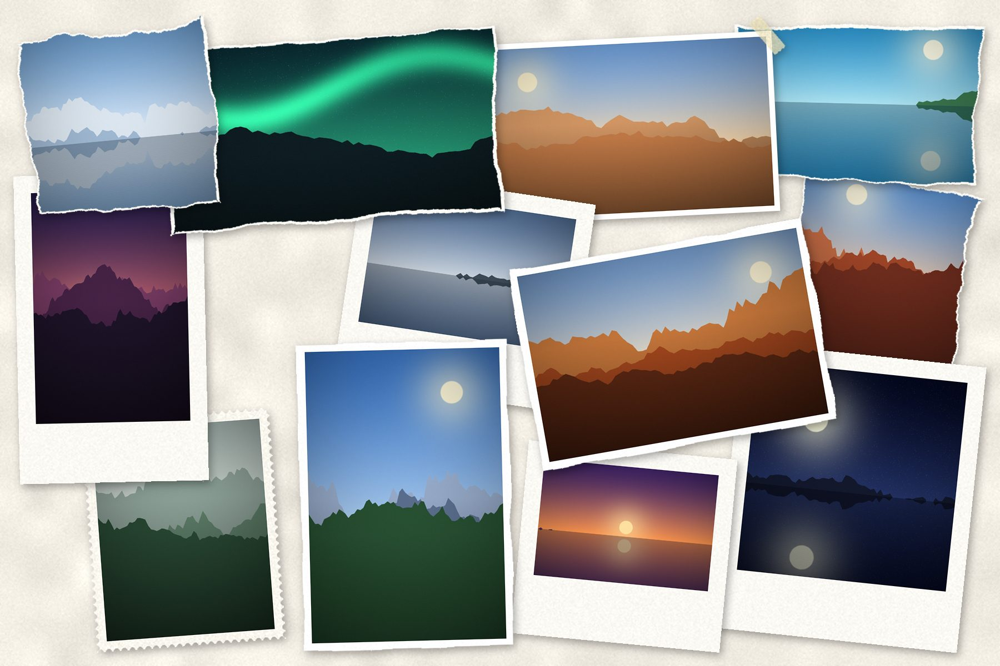
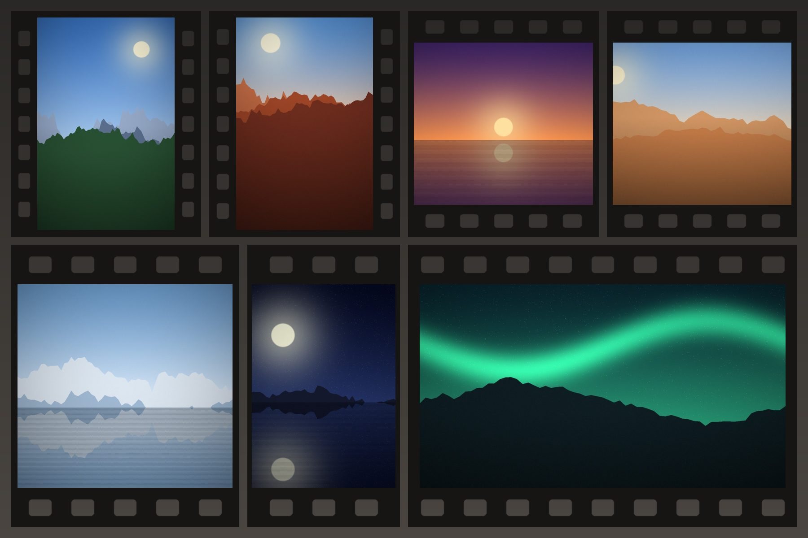
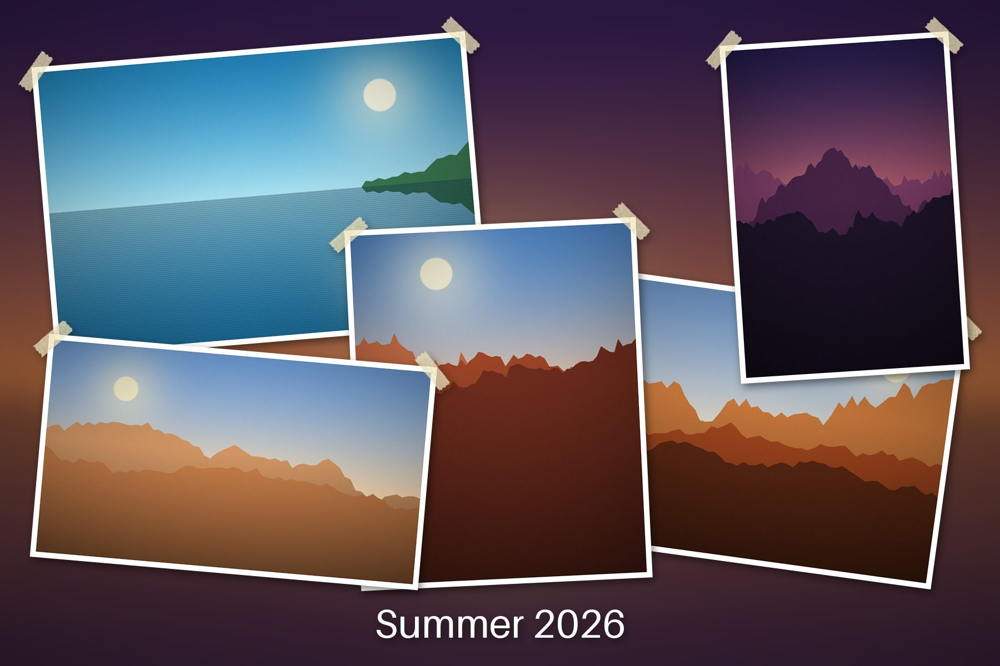
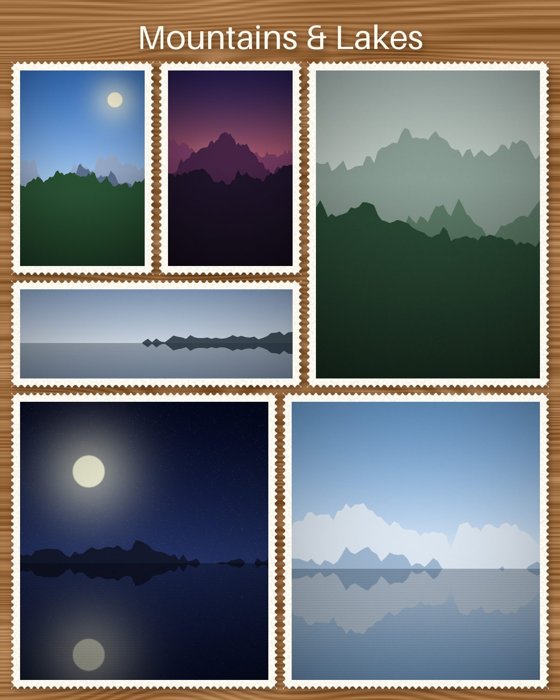
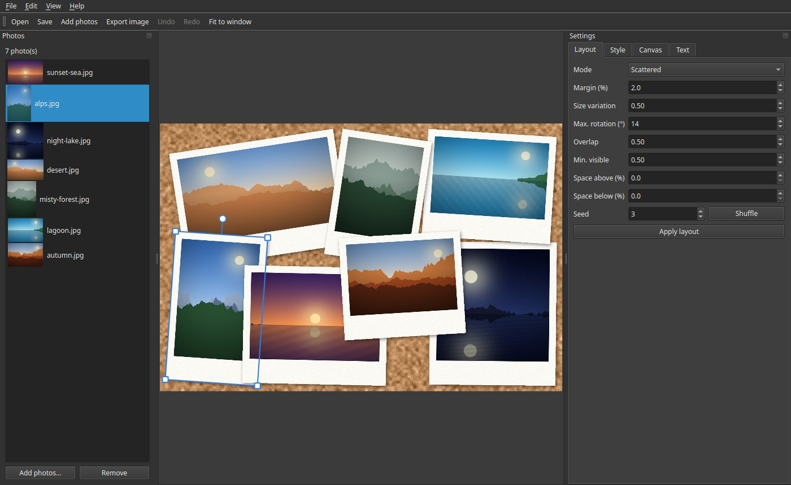

# Collagio

Photo collages for Windows and Linux: drop in 2–100 photos, pick a layout and a frame
style, adjust anything by hand, and export a print-ready PDF or an image.



> **Status:** version 0.1.0, the first release. See [CHANGELOG.md](CHANGELOG.md).

## Features

- **Two layouts:** a grid with mixed cell sizes that puts each photo into a cell of
  matching shape, or scattered photos with rotation, overlap and a guaranteed visible
  share of every photo
- **Seven frame styles**, for all photos or per photo: plain (border, rounded corners),
  postage stamp, scissor cut-out, torn paper, Polaroid (with caption), tape or photo
  corners, film strip; drop shadows
- **Backgrounds:** colour, gradient, paper/cork/wood texture or a blurred photo; titles
  and captions with font, colour, rotation and shadow
- **Desktop editor:** move, resize, rotate, swap and crop photos by hand, with undo/redo,
  live preview, autosave and crash recovery
- **Print:** sizes in mm or pixels (A6–A3, 10×15, …), DPI, bleed and crop marks in PDF
- **Command line** for scripted and batch use; projects are saved as `.collagio` files
- **English and German** interface
- Installers for Windows, AppImage and Flatpak for Linux

## Gallery

Every example below was made with the command line shown under it. The photos are
painted landscapes generated by [scripts/make_examples.py](scripts/make_examples.py),
which renders this gallery again.

| | |
|---|---|
|  |  |
| **Grid** with mixed cell sizes and rounded corners | **Mixed styles:** stamp, Polaroid, tape, torn paper and cut-out on paper |
| `--background "#f4f1ea" --corner-radius 10` | `--mode scattered --mix stamp,polaroid,tape,torn,cutout --background texture:paper --shadow 0.35` |
|  |  |
| **Film strip** on a dark gradient; the strip runs along each photo's long side | **Tape** on a blurred photo background, with a title |
| `--style filmstrip --background "#2a2826,#4a4540"` | `--mode scattered --style tape --background photo:sunset.jpg --title "Summer 2026" --title-shadow` |

<p align="center">
  <br>
  <b>Postage stamps</b> on wood, title on top:
  <code>--size 1200x1500 --style stamp --background texture:wood --title "Mountains &amp; Lakes" --title-position top</code>
</p>

## Installation

Download from the [releases page](https://github.com/Gamperle/Collagio/releases):

- **Windows:** `Collagio-X.Y.Z-setup.exe` (no admin rights needed; associates `.collagio`
  files) or the portable zip.
- **Linux:** `Collagio-X.Y.Z-x86_64.AppImage` (make it executable and run it), the Flatpak
  bundle (`flatpak install --user Collagio-X.Y.Z-x86_64.flatpak`), or the portable archive.
  The AppImage also contains the command line: `./Collagio-*.AppImage collagio --help`.
- **From source:** `pip install "collagio[gui]"` in a Python 3.12+ environment.

The interface follows the system language (English or German); *View > Language* changes it.

## Desktop editor



```bash
uv sync --extra gui      # or: pip install "collagio[gui]"
uv run collagio-gui      # optionally followed by photos, folders or a .collagio file
```

- Add photos with **File > Add photos**, the photo list's button, or by dropping files or
  folders onto the window. The Layout, Style and Canvas tabs change the whole collage;
  each "Apply" is one undo step.
- **Click** selects a photo (**Ctrl+click** adds to the selection), **drag** moves it. In grid
  mode, dropping a photo onto another one **swaps** them.
- **Corner handles** resize (aspect ratio kept), the **round handle** rotates (**Shift** snaps to
  15°).
- **Alt+drag** moves the photo inside its frame, **Ctrl+wheel** zooms it; *Edit > Reset crop*
  goes back to the automatic crop. The **mouse wheel** zooms the view, the **middle button** pans.
- Right-click a photo for stacking order, crop reset and removal. Undo/redo covers every edit.
- The **Text** tab adds titles and captions (size, colour, rotation, font, shadow); drag them on
  the canvas to move them. The **Canvas** tab offers solid, gradient, paper/cork/wood texture
  and blurred-photo backgrounds, and shows the size in mm.
- **File > Export image** renders the full-resolution PNG, JPEG or PDF in the background
  (cancellable); the options ask for quality, bleed and, for PDF, crop marks.
  Unsaved work is autosaved every two minutes (each window separately); *File > Recover
  unsaved work* brings it back after a crash.

## Command-line usage

```bash
collagio -i ./photos -o collage.png --size A4 --dpi 300 --seed 42
collagio -i a.jpg b.jpg c.jpg -o out.jpg --size fullhd --border 8 --corner-radius 12 \
         --background "#f4f1ea" --save-project my.collagio
collagio -i ./photos -o scattered.jpg --mode scattered --rotation 15 --overlap 0.7
collagio -i ./photos -o mixed.jpg --mode scattered --mix stamp,polaroid,tape,torn
collagio -i ./photos -o out.png --style polaroid --style-param "caption=Summer 2026"
collagio -i ./photos -o print.pdf --size A4 --bleed 3 --crop-marks --title "Summer 2026"
collagio -i ./photos -o wall.jpg --background texture:cork --style polaroid --mode scattered
collagio --project my.collagio -o out.png      # re-render a saved project
collagio --help                                     # all options
```

- **Sizes:** paper presets (`A5`, `A4`, `A3`, `10x15`, `13x18`, `20x30`), pixel presets
  (`fullhd`, `4k`, `instagram-square`, `instagram-portrait`), `1920x1080` or `210x297mm`;
  `--orientation portrait|landscape`
- **Layout:** `--gap` and `--margin` as a fraction of the canvas short edge,
  `--size-variation 0..1`, `--seed` for a reproducible layout (a random seed is printed)
- **Photo placement:** `--order shape` (default: photos go into cells of matching shape,
  least cropping), `random` (shuffled by the seed) or `input` (given order from the top-left);
  `--swap 1,4` exchanges two photos afterwards (by number in input order or by id such as
  `p004`, repeatable, also works with `--project`)
- **Scattered mode** (`--mode scattered`): rotated, overlapping photos. `--rotation` (max
  degrees, default 12), `--overlap 0..1` (default 0.5), `--min-visible 0..1` (share of every
  photo that stays uncovered, default 0.5; guaranteed)
- **Shadow:** `--shadow OPACITY` (default 0.45 in scattered mode, off in grid mode),
  `--shadow-blur`
- **Styles:** `--style plain|stamp|cutout|torn|polaroid|tape|filmstrip` for all photos;
  `--style-param KEY=VALUE` for any style parameter (e.g. `caption=Summer`, `value=60c`,
  `variant=corners`, `sides=top,bottom`, `orientation=vertical`); `--mix stamp,polaroid,...`
  gives each photo a random style from the list; `--photo-style 3=torn` sets one photo's style.
  Tiles are shaped for photo + frame, so frames do not crop the photo.
- **Plain style shortcuts:** `--border`, `--corner-radius` in 1/1000 of the canvas short edge,
  `--border-color`
- **Background:** one colour, two comma-separated colours for a gradient, `texture:paper|cork|wood`
  (optionally `,COLOR`), or `photo:PATH` (blurred, `--background-blur`, `--background-dim`)
- **Print:** `.pdf` output; `--bleed MM` extends the background on every side (all formats),
  `--crop-marks` adds crop marks outside the bleed (PDF); the PDF has TrimBox and BleedBox set
- **Title:** `--title TEXT` (`\n` for line breaks), `--title-position top|bottom|center` (top and
  bottom keep the photos clear), `--title-size`, `--title-color`, `--title-font FILE`,
  `--title-shadow`

## Development

Requires [uv](https://docs.astral.sh/uv/). See [CONTRIBUTING.md](CONTRIBUTING.md) for the
branch workflow, tests and translations, [TASK.md](TASK.md) for the specification and
[IMPLEMENTATION_PLAN.md](IMPLEMENTATION_PLAN.md) for the roadmap and test strategy.

```bash
uv sync                          # create .venv with Python 3.13 and dev tools
uv run pytest                    # run tests
uv run pytest --cov              # with coverage (gate: 85 %)
uv run pytest -m "not slow"      # skip slow tests
uv run pytest --update-golden    # regenerate golden reference images
uv run ruff check . && uv run ruff format --check .
uv run mypy
uv run pre-commit install        # run lint/type checks on every commit
```

Translations are described in [CONTRIBUTING.md](CONTRIBUTING.md#translations).

Packaging (normally done by the *Release* workflow):

```bash
uv sync --group build
uv run pyinstaller packaging/pyinstaller/collagio.spec --noconfirm --distpath build/dist
packaging/linux/build-appimage.sh   # needs appimagetool; writes build/release/*.AppImage
```

Generate the synthetic test photos to look at them, or render the README gallery again:

```bash
uv run python tests/fixtures/generate.py /tmp/collagio-photos --large
uv run python scripts/make_examples.py          # docs/images/*.jpg
```

## Licence

Collagio is free software, licensed under the
[GNU General Public License v3.0 or later](LICENSE).
